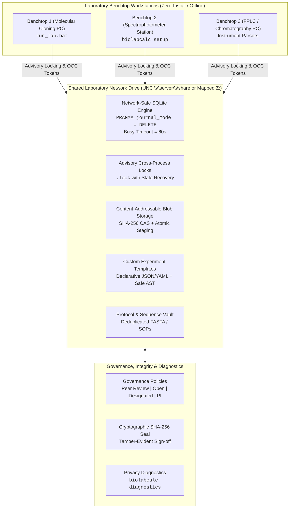

# BioLabCalc 🧬🔬

[](https://github.com/kabe89/BioLabCalc/actions)
[](https://pypi.org/project/biolabcalc/)
[](https://pypi.org/project/biolabcalc/)
[](https://github.com/kabe89/BioLabCalc/security)
[](https://github.com/kabe89/BioLabCalc/wiki)
[](#-running-tests)
[](https://opensource.org/licenses/MIT)
[](https://github.com/psf/black)

> **BioLabCalc** is an enterprise-grade, privacy-preserving computational biology suite, command-line benchtop assistant, interactive Excel generator, and browser-based Electronic Lab Notebook (ELN) / LIMS for daily wet-lab molecular biology, biochemistry, cloning, electrophoresis, and cell culture workflows. Operates seamlessly on local workstations, shared network drives (UNC / mapped drives), or zero-install portable bundles.

---

## 📖 Table of Contents

- [Overview & Value Proposition](#-overview--value-proposition)
- [Feature Comparison Matrix](#-feature-comparison-matrix)
- [System Architecture & Topology](#-system-architecture--topology)
- [Key Features & Capabilities](#-key-features--capabilities)
- [Installation & Portable Deployment](#-installation--portable-deployment)
  - [PyPI Installation](#from-pypi-recommended)
  - [Zero-Install Portable Run](#zero-install-portable-bundle-bench-pcs--usb)
  - [First-Run Setup Wizard](#first-run-setup-wizard)
- [Quick Start](#-quick-start)
  - [5-Minute Benchtop Cookbook](#-5-minute-benchtop-cookbook)
  - [Convenience API (`biolabcalc.easy`)](#-convenience-api-biolabcalceasy)
- [Shared Lab Network Storage & Concurrency](#-shared-lab-network-storage--concurrency)
- [No-Code Custom Experiment Builder](#-no-code-custom-experiment-builder)
- [Non-PI Peer-Review Governance](#-non-pi-peer-review-governance)
- [Failure Diagnostics & Remediation](#-failure-diagnostics--remediation)
- [Core Biophysics & Stoichiometry Modules](#-core-biophysics--stoichiometry-modules)
  - [1. Standardized Solution Prep & NanoDrop Predictor (`spectroscopy`)](#1-standardized-solution-prep--nanodrop-predictor)
  - [2. Molecular Cloning & Assembly (`cloning`)](#2-molecular-cloning--assembly)
  - [3. Western Blot Optimization & Troubleshooting (`western_blot`)](#3-western-blot-optimization--troubleshooting)
  - [4. Fluorophore Modifications & Degree of Labeling (`fluorescence`)](#4-fluorophore-modifications--degree-of-labeling-dol)
  - [5. Gel Migration & Molecular Weight Ladders (`gels`)](#5-gel-migration--molecular-weight-ladders)
  - [6. E. coli Growth & Induction Scheduling (`ecoli_growth`)](#6-e-coli-growth-kinetics--expression-optimization)
  - [7. PCR Kinetics & Master Mix Formulation (`pcr`)](#7-pcr-kinetics--protocol-optimization)
  - [8. In Vitro Transcription (IVT) Stoichiometry (`transcription`)](#8-in-vitro-transcription-ivt-stoichiometry)
  - [9. Molecular Weight & Molar Conversions (`molecular_weight`)](#9-molecular-weight--stoichiometry)
  - [10. Protein Quantification & Standard Curves (`protein`)](#10-protein-quantification--standard-curves)
  - [11. Primer Thermodynamics & SantaLucia Design (`primers`)](#11-primer-creator--thermodynamics)
  - [12. Laboratory Buffers & Temperature Shifts (`buffers`)](#12-laboratory-buffer--stock-recipes)
  - [13. Nucleic Acid Precipitation & Desalting (`precipitation`)](#13-nucleic-acid-precipitation--desalting)
  - [14. Interactive Drag-and-Drop Gel Annotator (`interactive_gel`)](#14-interactive-drag-and-drop-gel-annotator)
  - [15. Built-in Excel Workbook Generator (`excel_extension`)](#15-built-in-excel-workbook-generator)
- [Command-Line Interface (CLI)](#-command-line-interface-cli)
- [Documentation & 25-Page Wiki Directory](#-documentation--25-page-wiki-directory)
- [Planned Features & Strategic Roadmap](#-planned-features--strategic-roadmap)
- [Running Tests](#-running-tests)
- [Contributing](#-contributing)
- [Legal & Compliance Notice](#-legal--compliance-notice)
- [License](#-license)

---

## 🌟 Overview & Value Proposition

Modern life science research laboratories operate under significant friction:
* **Fragmented Calculations**: Researchers manually compute pipetting volumes, stock dilutions, molar ratios, and standard curves across ad-hoc spreadsheets prone to broken references (`#REF!`) and transcription mistakes.
* **Complex Multi-Step Stoichiometry**: High-stakes enzymatic reactions—such as Golden Gate Type IIS assemblies, Gibson/HiFi assemblies, in vitro transcriptions (IVT) with CleanCap analogs, and multiplex PCRs—require exact stoichiometric balance.
* **Multi-User Wet-Lab Isolation**: Traditional Electronic Lab Notebooks (ELNs) demand recurring cloud subscription fees, vendor lock-in, and constant internet access, conflicting with institutional data sovereignty policies and air-gapped instrument computers.

**BioLabCalc** solves this by unifying fundamental biophysical stoichiometry with an enterprise-grade, offline-first Electronic Lab Notebook. It operates effortlessly on a single laptop, an air-gapped benchtop PC, or across an entire research department via a shared local network drive (Windows UNC paths `\\server\share\data` or mapped drive letters `Z:\...`).

---

## 📊 Feature Comparison Matrix

| Capability / Dimension | BioLabCalc (v0.4.0) | Proprietary Cloud ELNs (Benchling, LabArchives) | Generic Spreadsheets (Excel / Sheets) |
| :--- | :---: | :---: | :---: |
| **Data Sovereignty & Privacy** | **100% Local / On-Premise Drive** | Stored on third-party cloud servers | Local file |
| **Zero-Install Portable Run** | **Yes (`run_lab.bat` / USB drive)** | Requires browser + paid account | Requires Microsoft Office license |
| **Shared Network Concurrency** | **Yes (UNC `\\server\share` & `Z:\`)** | Cloud sync only | High file-lock corruption risk |
| **Custom Experiment Builder** | **Declarative Safe AST Engine** | Limited / Enterprise tier only | Fragile cell formulas (`#VALUE!`) |
| **Non-PI Peer-Review Governance**| **4 Flexible Policies + Digital Seal**| Rigid top-down approval | None |
| **Biophysical Calculators** | **Native Built-in (PCR, IVT, Cloning)**| None (requires external tools) | Manual formula entry |
| **Instrument File Parsers** | **AKTA, pCLAMP, NanoDrop, Bio-Rad** | Expensive proprietary add-ons | Manual copy-pasting |
| **Failure Diagnostics** | **Plain-English Remediation** | Generic error banners | Cryptic system codes |
| **License & Cost** | **MIT (100% Free & Open Source)** | Recurring SaaS subscription ($/user/mo)| Software license fees |

---

## 🏛️ System Architecture & Topology



---

## 🚀 Key Features & Capabilities

* **Shared Network Drive Concurrency**: Built specifically for wet-labs sharing experimental databases over SMB/CIFS/NFS. Eliminates SQLite `-shm` network corruption using network-safe pragmas, PID/hostname advisory locking, atomic CAS blob staging, and Optimistic Concurrency Control (OCC).
* **No-Code Custom Experiment Builder**: Design custom assays using declarative schemas (Number, Text, Select, Boolean, Formula, Table, File). Evaluates complex multi-step formulas via a sandboxed, AST-safe mathematical engine (strictly blocks `eval` and arbitrary code execution). Includes 6 pre-built templates (qPCR, CRISPR screening, Michaelis-Menten kinetics, flow cytometry, PTSA, and transfection).
* **Non-PI Peer-Review Governance**: Four adaptable approval policies (`OPEN_COLLABORATION`, `PEER_REVIEW`, `DESIGNATED_REVIEWER`, `PI_APPROVAL`) with automated cryptographic SHA-256 tamper-evident digital sealing.
* **Shared Protocol, Sequence & Document Vault**: Centralized repository for SOP protocols, FASTA/GenBank sequences, and instrument attachments with content-addressed deduplication, full-text search, and JSON manifest export.
* **Zero-Install Portable Bundles**: Run BioLabCalc directly from a USB stick or network share without installation, administrator rights, or external C-extensions.
* **Plain-English Failure Diagnostics**: `biolabcalc diagnostics` automatically inspects system logs, SMB connection drops, and lock timeouts, presenting root-cause explanations and concrete remediation steps for bench scientists.
* **GxP 21 CFR Part 11 Audit Trail**: Immutable, append-only audit trail logging every parameter modification, operator ID, timestamp, and JSON delta state.

---

## 📦 Installation & Portable Deployment

### From PyPI (Recommended)
```bash
pip install biolabcalc
```

### Install with Optional Extras
```bash
# Install with Excel workbook generation support
pip install "biolabcalc[excel]"

# Install with image annotation and plotting support
pip install "biolabcalc[gel]"

# Install complete ELN server dependencies (FastAPI, Uvicorn, SQLAlchemy)
pip install "biolabcalc[eln]"

# Install all development and testing dependencies
pip install "biolabcalc[dev]"
```

### Zero-Install Portable Bundle (Bench PCs & USB)
Generate a self-contained portable distribution folder that runs on any bench computer with Python installed:
```bash
# Package portable distribution bundle to shared network folder
python scripts/package_portable.py -o "Z:\BioLabCalc_Portable"
```
On any laboratory workstation, researchers simply double-click `run_lab.bat` (Windows) or execute `./run_lab.sh` (macOS/Linux) to launch the ELN and calculators immediately.

### First-Run Setup Wizard
Configure your laboratory environment in 30 seconds via the interactive setup wizard:
```bash
# Interactive guided setup
python run.py setup

# Non-interactive automated deployment for laboratory workstations
python run.py setup --shared-dir "Z:\BioLabCalc_Data" --role client --non-interactive
```

---

## ⚡ Quick Start

### ⏱️ 5-Minute Benchtop Cookbook

| Daily Laboratory Task | CLI Command / Python Code | Expected Output / Result |
| :--- | :--- | :--- |
| **Dilute Stock Solution** | `biolabcalc dilute -c1 "100 mM" -c2 "25 mM" -v2 "16 mL"` | Pipette 4.0 mL stock + 12.0 mL diluent |
| **Reverse Complement Sequence** | `biolabcalc rc -s "ATGCGTACGTTAGC"` | `GCTAACGTACGCAT` |
| **Translate DNA to Protein** | `biolabcalc translate -s "ATGGCCATTGTAATGGGCCGCTGA"` | `MAIVMGR*` |
| **Batch CSV Sequence Processing** | `biolabcalc batch-csv -i samples.csv -c Sequence -o out.csv` | Batch calculates MW, Tm, GC%, and RC |
| **Neutralize 100 mM NTPs (pH 7.5)** | `biolabcalc ntp-ph -v 4.0 -c 100 -V 16 -C 25 -f disodium_salt` | Add 108.5 µL 5 M NaOH, QS to 16 mL |
| **Scale 10X PBS Recipe (500 mL)** | `biolabcalc buffer -b 10X_PBS -v 500` | 40.0 g NaCl, 1.0 g KCl, 7.2 g Na2HPO4, 1.2 g KH2PO4 |
| **Plan EcoRI + BamHI Digest** | `biolabcalc digest -m 1.0 -v 50 -e1 EcoRI -e2 BamHI -c 200` | 5 µL 10X rCutSmart, 5 µL DNA, 1 µL each enzyme |
| **Check Overhang Compatibility** | `python -c "import biolabcalc as blc; print(blc.are_overhangs_compatible('BamHI', 'BglII'))"` | Compatible cohesive ends (`GATC`) |
| **Golden Gate Assembly (BsaI)** | `biolabcalc golden-gate --vec-bp 4500 --ins-bp 1200 600 --fmol 20` | Vector: 58.5 ng; Insert 1: 31.2 ng; Insert 2: 15.6 ng |
| **NanoDrop Purity Check** | `biolabcalc purity --a260 1.25 --a280 0.63 --a230 0.58 -t rna` | Status: PURE (A260/A280 = 1.98, A260/A230 = 2.16) |
| **Phenol:Chloroform Extraction** | `biolabcalc pci -v 150 -t rna` | 150 µL Sample + 150 µL PCI (pH 4.5) + 150 µL Chloroform |
| **Precipitate Low-Yield RNA** | `biolabcalc precipitate -v 100 -t rna -a ethanol -s naoac` | Add 10 µL 3M NaOAc, 1 µL GlycoBlue, 300 µL 100% EtOH |
| **Interactive Guided Wizard** | `biolabcalc wizard` | Step-by-step prompted menu for bench calculations |
| **View System Diagnostics** | `biolabcalc diagnostics` | Plain-English health inspection and failure remediation |
| **Launch Electronic Lab Notebook** | `biolabcalc eln --port 8080` | Opens modern web ELN in browser |

---

### 🧪 Convenience API (`biolabcalc.easy`)

For interactive work in Jupyter notebooks, IPython, or quick scripts, `biolabcalc.easy` accepts human-readable strings with automatic unit parsing:

```python
import biolabcalc.easy as easy

# 1. Quick C1*V1 = C2*V2 dilution with unit strings
res = easy.dilute(c1="100 mM", c2="25 mM", v2="16 mL")
print(f"Pipette {res['v1']/1000:.2f} mL stock + {res['diluent_needed']/1000:.2f} mL diluent.")

# 2. Reverse complement and six-frame translation
rc_seq = easy.rc("ATGCCGTCCAGGCTGCTG")
aa_seq = easy.translate("ATGCCGTCCAGGCTGCTG")

# 3. Scale laboratory buffer
pbs = easy.buffer("10X_PBS", volume="500 mL")

# 4. Primer Tm and SantaLucia thermodynamics
primer = easy.primer("ATGCCGTCCAGGCTGCTG", primer_conc="400 nM")
print(f"Tm: {primer.tm_celsius:.1f}°C, GC: {primer.gc_percent:.1f}%")

# 5. Golden Gate Assembly setup (BsaI-HFv2)
gg = easy.golden_gate(vector_bp=4500, insert_bps=[1200, 600], target_fmol=20.0, enzyme="BsaI-HFv2")
print(f"Vector: {gg.vector_mass_ng:.1f} ng | Inserts: {gg.insert_masses_ng} ng")

# 6. NanoDrop nucleic acid purity diagnostics
purity = easy.nanodrop_purity(a260=1.25, a280=0.63, a230=0.58, sample_type="rna")
print(f"Status: {purity.purity_status.upper()} -> {purity.diagnostic_feedback[0]}")
```

---

## 🗄️ Shared Lab Network Storage & Concurrency

BioLabCalc includes a dedicated multi-user concurrency engine designed specifically for academic labs and biotech facilities operating over shared network shares:

```python
from biolabcalc.eln.storage.network_storage import NetworkShareStorageManager

# Initialize network share manager (supports Windows UNC and mapped drives)
manager = NetworkShareStorageManager(
    shared_dir=r"\\server\biology_share\eln_data",
    lock_timeout_seconds=60,
)

# Concurrency-safe atomic block execution
with manager.acquire_lock("campaign_cloning_2026"):
    # Critical section: atomic file modifications across network
    blob_hash = manager.store_blob_atomic(b"Sample fasta payload", filename="construct.fasta")
```

### Network Safety Mechanisms:
1. **Network-Safe SQLite Pragmas**: Enforces `PRAGMA journal_mode = DELETE; PRAGMA busy_timeout = 60000; PRAGMA locking_mode = NORMAL;` to eliminate CIFS/SMB WAL shared-memory (`-shm`) corruption.
2. **Advisory File Locking**: Implements host/PID-attributed `.lock` files with automatic stale lock reclamation after configurable timeouts.
3. **Atomic CAS Blob Staging**: Staged atomic writes (`os.replace`) prevent partially-written files across unstable network shares.
4. **Optimistic Concurrency Control (OCC)**: Entries carry UUID `version_token` stamps; simultaneous modifications trigger conflict alerts with merge options rather than silent overwrites.

---

## 🧪 No-Code Custom Experiment Builder

Wet-lab experiments vary wildly across disciplines. BioLabCalc allows researchers without programming experience to define custom experiment templates with declarative formulas:

```python
from biolabcalc.eln.services.custom_experiment_service import CustomExperimentService

service = CustomExperimentService()

# 1. Fetch preloaded templates
templates = service.list_templates()
# Available: qPCR Assay, CRISPR Screening, Enzyme Kinetics, Flow Cytometry, PTSA, Transfection

# 2. Create entry with custom inputs; formulas evaluate automatically via safe AST engine
entry = service.create_entry(
    template_id="tpl_enzyme_kinetics",
    campaign_id="CMP-ENZ-01",
    title="Beta-Galactosidase Michaelis-Menten Run",
    form_data={
        "substrate_conc_um": 50.0,
        "reaction_time_min": 10.0,
        "delta_absorbance": 0.42,
        "extinction_coefficient": 0.015,
        "enzyme_mass_ug": 5.0,
    },
    operator_id="researcher_lead",
)

print(f"Calculated Velocity: {entry.calculated_values['velocity_um_per_min']:.3f} µM/min")
print(f"Specific Activity:  {entry.calculated_values['specific_activity_u_per_mg']:.2f} U/mg")
```

---

## 🛡️ Non-PI Peer-Review Governance

Traditional ELNs bottleneck research by requiring PI sign-off on every bench entry. BioLabCalc introduces flexible governance policies:

```python
from biolabcalc.eln.services.approval_service import ApprovalService, ApprovalPolicy

approval_service = ApprovalService(default_policy=ApprovalPolicy.PEER_REVIEW)

# Submit entry for peer review
approval_service.submit_for_approval("entry_id_101", submitter_id="postdoc_01")

# Any qualified lab peer reviews and approves with sign-off comments
seal = approval_service.approve(
    entry_id="entry_id_101",
    reviewer_id="senior_scientist_02",
    reviewer_role="peer_reviewer",
    comments="Primer designs, band sizes, and stoichiometry verified against gel scan.",
)

print(f"Tamper-Evident SHA-256 Seal: {seal.seal_hash}")
```

---

## 🔍 Failure Diagnostics & Remediation

When a command fails or a network share drops, wet-lab researchers should not have to decipher Python tracebacks. BioLabCalc translates errors into plain-English diagnostics:

```bash
# View recent system failure diagnostics
biolabcalc diagnostics
```

```text
======================================================================
  BIOLABCALC SYSTEM DIAGNOSTICS: RECENT FAILURES (LAST 1)
======================================================================
[!] Failure #1: NETWORK_STORAGE at 2026-11-13 10:15:32
    Error: Network lock timeout after 60s on '\\server\share\data\.lock'
    Root Cause: Another workstation held the shared database lock.
    Remediation:
      1. Check if another workstation is performing a large batch import.
      2. If workstation crashed, verify stale lock via: biolabcalc portable
      3. Increase timeout in config.yaml: lock_timeout_seconds: 120
======================================================================
```

---

## 🔬 Core Biophysics & Stoichiometry Modules

### 1. Standardized Solution Prep & NanoDrop Predictor
```python
from biolabcalc.spectroscopy import prepare_standard_solution

sol = prepare_standard_solution(
    target_molarity_um=4.0,
    target_volume_ul=500.0,
    seq_type="rna",
    rna_length_nt=36,
    stock_conc_ng_ul=500.0,
)
print(f"Required Mass: {sol.required_mass_ug:.2f} µg ({sol.required_moles_nmol:.2f} nmol)")
print(f"Predicted NanoDrop A260: {sol.expected_nanodrop_a260_1cm:.3f} AU")
```

### 2. Molecular Cloning & Assembly
```python
from biolabcalc.cloning import plan_restriction_digest, calculate_gibson_assembly, calculate_golden_gate_assembly

# Plan double digest with buffer compatibility
digest = plan_restriction_digest(dna_mass_ug=2.0, reaction_volume_ul=50.0, enzyme_1="EcoRI", enzyme_2="BamHI")

# Gibson Assembly stoichiometry (NEBuilder HiFi)
gibson = calculate_gibson_assembly(vector_length_bp=4500, insert_lengths_bp=[1200, 800], vector_mass_ng=100.0)

# Golden Gate Assembly (Type IIS: BsaI, BsmBI, BbsI)
golden_gate = calculate_golden_gate_assembly(vector_length_bp=4500, insert_lengths_bp=[1200, 600], target_vector_fmol=20.0)
```

### 3. Western Blot Optimization & Troubleshooting
```python
from biolabcalc.western_blot import calculate_transfer_conditions, calculate_lysate_loading, troubleshoot_western_blot

# Wet tank vs semi-dry transfer conditions
transfer = calculate_transfer_conditions(target_mw_kda=120.0, transfer_system="wet_tank", membrane_type="pvdf")

# Lysate loading with multi-pass transmembrane protein denaturation check
loading = calculate_lysate_loading(lysate_conc_mg_ml=2.5, target_protein_ug_per_lane=20.0, sample_buffer_conc=4, is_membrane_protein=True)

# Diagnostic troubleshooting lookup
trouble = troubleshoot_western_blot("ghost_bands")
print(f"Likely causes: {trouble.likely_causes[0]}")
```

### 4. Fluorophore Modifications & Degree of Labeling (DOL)
```python
from biolabcalc.fluorescence import apply_fluorophore_modification, calculate_degree_of_labeling
from biolabcalc.molecular_weight import calculate_dna_mw

dna = calculate_dna_mw("ATGCCGTCCAGGCTGCTGGTC")
labeled = apply_fluorophore_modification(dna, ["FAM", "BHQ1"])

# Quantify labeling efficiency from spectrophotometer readings
dol = calculate_degree_of_labeling(
    absorbance_max_dye=0.65,
    absorbance_260=1.25,
    fluorophore_name="FAM",
    oligo_extinction_coeff=360000,
)
print(f"Degree of Labeling: {dol.degree_of_labeling:.2f} ({dol.interpretation})")
```

### 5. Gel Migration & Molecular Weight Ladders
```python
from biolabcalc.gels import simulate_gel

# LADDER OPTIONS: "1kb_dna", "100bp_dna", "low_range_ssdna", "protein_broad_range"
sim = simulate_gel(sample_sizes=[450, 1200, 3000], ladder_key="1kb_dna")
print(sim.ascii_visualization)
```

### 6. E. coli Growth Kinetics & Expression Optimization
```python
from biolabcalc.ecoli_growth import calculate_ecoli_growth, estimate_plasmid_yield, optimize_protein_induction

# Time to induction OD600
growth = calculate_ecoli_growth(initial_od600=0.05, target_od600=0.65, temperature_celsius=37.0, media="LB")

# Estimate plasmid prep yield
plasmid = estimate_plasmid_yield(culture_volume_ml=5.0, final_od600=3.0, plasmid_type="pUC")

# Recombinant protein yield advisor
prot = optimize_protein_induction(protein_mw_da=45000, culture_volume_ml=1000.0, final_od600=4.0)
```

### 7. PCR Kinetics & Master Mix Formulation
```python
from biolabcalc.pcr import calculate_pcr_kinetics, optimize_pcr_protocol, build_master_mix

# Polymerase-specific annealing and extension schedules
protocol = optimize_pcr_protocol(primer_fwd_tm=60.5, primer_rev_tm=60.0, amplicon_len_bp=800, polymerase="q5")

# Multi-reaction master mix with 10% pipetting excess
master_mix = build_master_mix(num_reactions=24, reaction_volume_ul=50.0, excess_percent=10.0)
```

### 8. In Vitro Transcription (IVT) Stoichiometry
```python
from biolabcalc.transcription import calculate_ivt_yield

ivt = calculate_ivt_yield(
    rna_seq="TAATACGACTCACTATAGGGAGACCCAAGCUGGCC",
    reaction_volume_ul=20.0,
    measured_yield_ug=40.0,
    auto_trim_promoter=True,
    add_5prime_gg=2,
    modified_ntp="m1Psi",
    cap_analog="CleanCap_AG",
)
print(f"Transcript Length: {ivt.rna_length} nt | MW: {ivt.rna_mw:,.2f} Da")
print(f"Predicted Capping Efficiency: {ivt.predicted_capping_efficiency_percent:.0f}%")
```

### 9. Molecular Weight & Stoichiometry
```python
from biolabcalc.molecular_weight import calculate_dna_mw, calculate_rna_mw, calculate_protein_mw, mass_to_moles

dna_mw = calculate_dna_mw("ATGCCGTCCAGGCTGCTGGTC", is_double_stranded=True)
moles = mass_to_moles(mass_g=100e-9, mw_da=dna_mw.average_mw)
print(f"100 ng = {moles*1e12:.2f} pmol")
```

### 10. Protein Quantification & Standard Curves
```python
from biolabcalc.protein import quantify_protein_a280, calculate_extinction_coefficient, fit_standard_curve

# Sequence-based extinction coefficient (Pace et al., 1995)
ext = calculate_extinction_coefficient("MKWVTFISLLLLFSSAYSRG")
conc = quantify_protein_a280(absorbance_280=0.85, extinction_coeff_m_cm=ext.extinction_coefficient_reduced, protein_mw_da=ext.molecular_weight)
```

### 11. Primer Creator & Thermodynamics
```python
from biolabcalc.primers import analyze_primer, design_primers

# Nearest-neighbor SantaLucia (1998) thermodynamics
p_analysis = analyze_primer("ATGCCGTCCAGGCTGCTGGTC", primer_conc_nm=400.0, na_conc_mm=50.0, mg_conc_mm=1.5)
print(f"Tm: {p_analysis.tm_celsius:.1f}°C | GC: {p_analysis.gc_percent:.1f}%")
```

### 12. Laboratory Buffer & Stock Recipes
```python
from biolabcalc.buffers import calculate_buffer_recipe, calculate_ntp_ph_adjustment, calculate_tris_temperature_shift

# Scale 10X PBS recipe
recipe = calculate_buffer_recipe("10X_PBS", target_volume_ml=1000.0)

# Temperature shift of Tris buffer (25°C to 4°C cold room)
tris_shift = calculate_tris_temperature_shift(ph_at_t1=8.0, t1_celsius=25.0, t2_celsius=4.0)

# 25 mM NTP neutralization to pH 7.5
ntp_ph = calculate_ntp_ph_adjustment(initial_volume_ml=4.0, target_volume_ml=16.0, starting_form="disodium_salt")
```

### 13. Nucleic Acid Precipitation & Desalting
```python
from biolabcalc.precipitation import calculate_precipitation, calculate_phenol_chloroform_extraction

# Ethanol precipitation with GlycoBlue carrier
precip = calculate_precipitation(sample_volume_ul=100.0, nucleic_acid="rna", alcohol="ethanol", salt="naoac")

# Phenol:Chloroform phase separation
pci = calculate_phenol_chloroform_extraction(sample_volume_ul=150.0, nucleic_acid="rna")
```

### 14. Interactive Drag-and-Drop Gel Annotator
```python
from biolabcalc.interactive_gel import launch_interactive_annotator, save_interactive_app

# Launch standalone browser application
launch_interactive_annotator(port=8501)

# Or export self-contained HTML file for offline sharing
save_interactive_app("Interactive_Gel_App.html")
```

### 15. Built-in Excel Workbook Generator
```python
from biolabcalc.excel_extension import generate_lab_notebook_template

# Generate multi-tab Excel notebook with live formulas
generate_lab_notebook_template("BioLab_Interactive_Notebook.xlsx")
```

---

## 💻 Command-Line Interface (CLI)

BioLabCalc provides a full-featured terminal CLI with subcommands for all wet-lab calculations and deployments:

```bash
# 1. Solution Dilution (C1*V1 = C2*V2)
biolabcalc dilute -c1 "100 mM" -c2 "25 mM" -v2 "16 mL"

# 2. Sequence Reverse Complement & Translation
biolabcalc rc -s "ATGCGTACGTTAGC"
biolabcalc translate -s "ATGGCCATTGTAATGGGCCGCTGA"

# 3. High-Throughput Batch Processing from CSV
biolabcalc batch-csv -i samples.csv -c Sequence -o processed_samples.csv

# 4. NTP Neutralization & pH Adjustment
biolabcalc ntp-ph -v 4.0 -c 100 -V 16 -C 25 -f disodium_salt

# 5. Buffer Scaling (500 mL of 50X TAE)
biolabcalc buffer -b 50X_TAE -v 500

# 6. Golden Gate Assembly (Type IIS)
biolabcalc golden-gate --vec-bp 4500 --ins-bp 1200 600 --fmol 20 --enzyme BsaI-HFv2

# 7. Gibson Assembly / NEBuilder HiFi
biolabcalc gibson --vec-bp 5000 --ins-bp 850 1500 --vec-ng 100

# 8. Restriction Enzyme Digest Setup
biolabcalc digest --dna-ug 2.0 -e1 EcoRI -e2 BamHI --dna-conc 250

# 9. NanoDrop Purity Assessment
biolabcalc purity --a260 1.25 --a280 0.63 --a230 0.58 -t rna

# 10. Gel Lane Image Annotation
biolabcalc annotate-gel \
    --lanes "Ladder,Ctrl,Clone1,Clone2,Digest" \
    --ladder 1kb_dna \
    --ladder-lane 1 \
    --bands "3:850:Amplicon,4:850:Amplicon,5:3500:Vector" \
    --title "Colony PCR Screening" \
    --output "annotated_gel.png"

# 11. View System Diagnostics & Remediation
biolabcalc diagnostics

# 12. First-Run Setup Wizard
biolabcalc setup --shared-dir "Z:\BioLabData" --role client --non-interactive

# 13. Inspect Portable Environment Status
biolabcalc portable

# 14. Launch Electronic Lab Notebook (ELN) Server
biolabcalc eln --port 8080
```

---

## 📚 Documentation & 25-Page Wiki Directory

Comprehensive documentation, scientific derivations, and deployment guides are hosted on the [BioLabCalc GitHub Wiki](https://github.com/kabe89/BioLabCalc/wiki):

| Scientific Domain | Wiki Guide | Description |
| :--- | :--- | :--- |
| **Getting Started** | [Home](https://github.com/kabe89/BioLabCalc/wiki/Home) · [Getting Started](https://github.com/kabe89/BioLabCalc/wiki/Getting-Started) | System overview, first-run wizard, and environment setup. |
| **API & CLI Reference** | [CLI Quick Reference](https://github.com/kabe89/BioLabCalc/wiki/CLI-Reference) · [Python API Reference](https://github.com/kabe89/BioLabCalc/wiki/Python-API-Reference) | Complete CLI argument flags and Python API signatures. |
| **Core Biophysics** | [Core Stoichiometry](https://github.com/kabe89/BioLabCalc/wiki/Core-Calculators-&-Biophysics) · [Solution Prep](https://github.com/kabe89/BioLabCalc/wiki/Solution-Prep-&-Spectroscopy) | Mass/moles math, Beer-Lambert $A_{260}/A_{280}$ derivations, and stock dilutions. |
| **Chemical Formulations** | [Buffers & Precipitation](https://github.com/kabe89/BioLabCalc/wiki/Buffers-&-Precipitation) | Catalog of biological buffers, Tris temperature shifts, and NTP neutralization. |
| **Protein Sciences** | [Protein Quantification](https://github.com/kabe89/BioLabCalc/wiki/Protein-Quantification) · [Western Blotting](https://github.com/kabe89/BioLabCalc/wiki/Western-Blotting-Suite) | Pace (1995) extinction coefficients, wet-tank transfer, and troubleshooting. |
| **Molecular Assembly** | [Molecular Cloning](https://github.com/kabe89/BioLabCalc/wiki/Molecular-Cloning-&-Assembly) · [PCR Kinetics](https://github.com/kabe89/BioLabCalc/wiki/PCR-Kinetics-&-Primer-Design) | Gibson HiFi, Golden Gate Type IIS, SantaLucia $T_m$, and master mix formulas. |
| **Transcription & Growth**| [In Vitro Transcription](https://github.com/kabe89/BioLabCalc/wiki/In-Vitro-Transcription-(IVT)) · [Bacterial Growth](https://github.com/kabe89/BioLabCalc/wiki/Bacterial-Growth-Modeling) | IVT capping efficiency (CleanCap), modified NTPs, and E. coli doubling kinetics. |
| **Visualization Tools** | [Gel Electrophoresis](https://github.com/kabe89/BioLabCalc/wiki/Gel-Electrophoresis-&-Image-Annotator) · [Excel Integration](https://github.com/kabe89/BioLabCalc/wiki/Interactive-Excel-Integration) | Interactive gel annotator and 7-tab Excel workbook generation. |
| **ELN & Multi-Modal LIMS**| [ELN Architecture](https://github.com/kabe89/BioLabCalc/wiki/Electronic-Lab-Notebook-(ELN)) · [SOP Management](https://github.com/kabe89/BioLabCalc/wiki/SOP-&-Protocol-Management) | Multi-user network concurrency, immutable protocol forking, and execution checklists. |
| **Data & Instrument Parsing**| [Instrument Data Parsers](https://github.com/kabe89/BioLabCalc/wiki/Instrument-Data-Parsers) · [Freezer LIMS](https://github.com/kabe89/BioLabCalc/wiki/Inventory-&-Freezer-LIMS) | AKTA FPLC, pCLAMP ephys, NanoDrop, Bio-Rad gel parsing, and 2D storage grids. |
| **Compliance & Operations**| [GxP & Audit Trails](https://github.com/kabe89/BioLabCalc/wiki/GxP-Compliance-&-Audit-Trails) · [Developer Guide](https://github.com/kabe89/BioLabCalc/wiki/Developer-&-Deployment-Guide) | 21 CFR Part 11 append-only audit trail, network storage configuration, and Docker. |

---

## 🔮 Planned Features & Strategic Roadmap

We are actively expanding BioLabCalc to support broader wet-lab assays, enterprise authentication, and hardware automation:

### 1. Expanded Preloaded Experiment Templates (Community Brainstorming)
* **Next-Generation Sequencing (NGS) Library Prep**: Automated fragmentation sizing, adapter-to-insert molar ratios, magnetic SPRI bead double-sided cleanup ratios, and Bioanalyzer QC pooling.
* **ELISA 4-Parameter Logistic (4PL) Regression**: Sigmoidal standard curve fitting, $EC_{50}$ calculation, and automated concentration interpolation for immunoassays.
* **Isothermal Nucleic Acid Amplification**: Protocol calculators for Loop-Mediated Isothermal Amplification (LAMP/RT-LAMP) and Rolling Circle Amplification (RCA).
* **Cell Viability & Cytotoxicity Regressions**: Background-corrected MTT, CCK-8, and AlamarBlue survival curves with automatic $IC_{50}$ estimation.
* **Quantitative Western Blot Densitometry**: Normalized densitometric ratio calculation against housekeeping controls (GAPDH, β-actin, α-tubulin).
* **Proteomics Enzymatic Digestion**: Trypsin and Lys-C cleavage scheduling, missed cleavage tracking, and stage-tip desalting calculations.

### 2. Granular User Privileges, RBAC & Enterprise Authentication
* **Credential-Based Session Logins**: Form-based authentication (`/login`) with secure session tokens and password rotation.
* **Role-Based Access Control (RBAC)**: Fine-grained permission matrices across Lab Director / PI, Senior Postdoc, Graduate Student, Core Facility Staff, and External Auditor.
* **Institutional Single Sign-On (SSO)**: Lightweight LDAP and Active Directory integration for university and research hospital networks.
* **Project-Level Access Control Lists (ACLs)**: Confidential campaign isolation to restrict read/write visibility between collaborative or proprietary industry research teams.

### 3. Real-Time Collaboration & Hardware Integration
* **Mobile-Optimized Optical 2D Barcode Scanner**: WebRTC camera integration to scan cryogenic tube DataMatrix codes directly at the freezer.
* **WebSocket Real-Time Co-Authoring**: Live presence indicators and section locking for multi-user notebook sessions.

---

## 🧪 Running Tests

BioLabCalc features an exhaustive test suite with zero external dependencies required for core physical, mathematical, and biophysical verification:

```bash
# Run complete test suite using pytest
pytest tests/
```

```text
======================= 392 passed, 7 skipped in 5.28s =======================
```

All 392 automated test items execute cleanly across Python 3.8, 3.9, 3.10, 3.11, and 3.12 with 100% mathematical accuracy.

```bash
# Run Git Security & PII Compliance Audit
python scripts/security_audit.py

# Verify Wiki Link Integrity
python scripts/verify_wiki.py
```

---

## 🤝 Contributing

Contributions to BioLabCalc are warmly welcomed! Please review our [Contributing Guide](CONTRIBUTING.md) and [Code of Conduct](CODE_OF_CONDUCT.md) before getting started.

1. **Fork the Repository**: Click "Fork" at [github.com/kabe89/BioLabCalc](https://github.com/kabe89/BioLabCalc).
2. **Create a Feature Branch**:
   ```bash
   git checkout -b feature/my-new-calculation
   ```
3. **Write Tests & Implement**: Ensure all calculations cite peer-reviewed literature and include unit tests in `tests/`.
4. **Run Verification**:
   ```bash
   pytest tests/
   python scripts/security_audit.py
   ```
5. **Commit Cleanly**: Follow conventional commit conventions (`feat:`, `fix:`, `docs:`, `test:`).
6. **Open a Pull Request**: Submit your pull request for review on GitHub.

---

## ⚖️ Legal & Compliance Notice

BioLabCalc is developed for open scientific research. For regulatory, export control, biosecurity, and dependency audit details, consult [LEGAL.md](LEGAL.md).

* **Research Use Only (RUO)**: BioLabCalc is designed solely for academic research and educational purposes. It is **not** certified, validated, or intended for human or animal clinical diagnostics, medical treatment, or therapeutic manufacturing.
* **Biosecurity & Export Control**: All algorithms are based on fundamental, publicly available scientific research (15 CFR § 734.7 & § 734.8; EAR99). The software contains no select agent design pipelines or dual-use biosecurity evasion mechanisms.
* **Permissive Dependencies**: All upstream dependencies (`openpyxl`, `matplotlib`, `Pillow`, `numpy`) use OSI-approved permissive licenses (MIT, PSF, HPND, BSD-3-Clause) with zero copyleft (GPL/AGPL) restrictions.
* **Data Sovereignty**: Sequence data, primer designs, experimental formulations, and laboratory notebooks created by users are saved solely to local file storage and are never transmitted to external servers.
* **Nominative Fair Use**: All product names, logos, and trademarks (e.g. Gibson Assembly®, NanoDrop™, Coomassie®, Triton™, Tween®, Q5®, Phusion®) are the property of their respective owners and are referenced under nominative fair use without endorsement.

---

## 📄 License

MIT License. See [LICENSE](LICENSE) for details.
